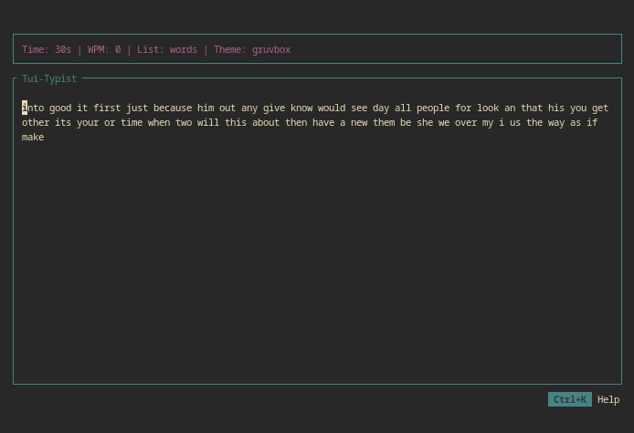
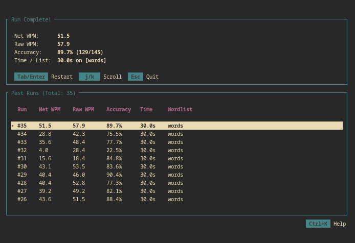

# Tui-Typist

A lightweight, Terminal typing test built in Rust with `ratatui`.

| Typing Screen | Results & History |
| :---: | :---: |
|  |  |
## Features
- **Live Metrics & History:** Tracks Net WPM, Raw WPM, and Accuracy, saving past runs to `history.jsonl` with personal best highlighting and Vim-style scrolling.
- **Timer Presets:** Switch between `30s`, `60s`, and `90s` runs on the fly.
- **Lua Theming:** Customize every UI color via `.lua` scripts in `themes/`.
- **Custom Wordlists:** Drop any `.txt` file into `wordlists/` and cycle through them live.

## Installation & Usage
```bash
git clone https://github.com/bolobtw/Tui-Typist.git
cd Tui-Typist
cargo run --release
```

## Keybinds

| Keybind | Action |
| :--- | :--- |
| `Tab` | Quick restart at any time |
| `Ctrl+Backspace` | Delete whole word |
| `Ctrl+D` | Cycle timer duration (`30s` / `60s` / `90s`) |
| `Ctrl+W` | Cycle wordlists from the `wordlists/` folder |
| `Ctrl+T` | Cycle themes from the `themes/` folder |
| `j`/`k` or `Arrow Keys` | Scroll through past runs on the results screen |
| `Ctrl+K` | Toggle the keybinds help menu |
| `Esc` | Close out of the application |

## Theming
Supports Lua themes placed in `Tui-Typist/themes/`.

**Example of a `theme.lua` file:**
```lua
return {
    header = "#b16286",
    correct = "#b8bb26",
    incorrect_fg = "#fb4934",
    incorrect_bg = "#500000",
    untyped = "#ebdbb2",
    active_fg = "#3c3836",
    active_bg = "#ebdbb2",
    border = "#458588",
}
```

## Custom Wordlists
The provided wordlist is minimal and easily replaceable. Place any whitespace-separated `.txt` file in `Tui-Typist/wordlists/` or edit the default file, then press `Ctrl+W` in the app to cycle through your wordlists.

---

Any feedback or bug reports are appreciated!